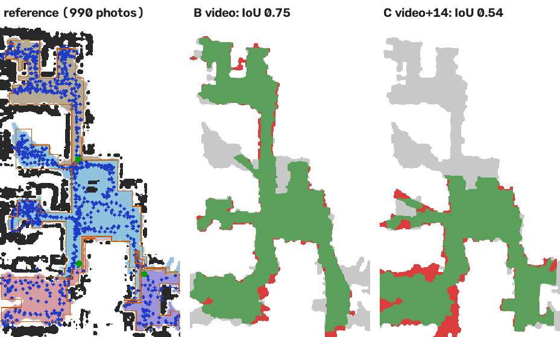

# نتیجه‌ی آزمون فاز صفر

**پرسش اصلی:** آیا ویدئو دقت بازسازی را بیشتر می‌کند یا عکس کافی است؟
**پاسخ کوتاه:** بله. با این خط تولید، عکس‌های پراکنده‌ی آگهی اصلاً مدل قابل‌استفاده نمی‌سازند و ویدئوی گردش در خانه مدل درست می‌سازد.
اما ترکیب ویدئو با چند عکس، در شکل فعلی، نتیجه را **بدتر** کرد.

## داده و روش

- **صحنه:** آپارتمان «nyc» از مجموعه‌داده‌ی پژوهشی Zip-NeRF، شامل ۹۹۰ عکس پشت‌سرهم از گردش در خانه (بدون اطلاعات لنز).
- **مرجع:** بازسازی همراه مجموعه‌داده از هر ۹۹۰ عکس، و پلانی که خط تولید خود ما از آن بیرون کشید. حدود ۷۵ متر مربع کف دیده‌شده و سقف ۲٫۲۸ متر.
- **ورودی‌های آزمون:**
  - **A14 / A30:** ۱۴ یا ۳۰ عکس با فاصله‌ی یکنواخت در طول مسیر. هرکدام واضح‌ترین عکس در همسایگی خودش است، شبیه عکس‌های یک آگهی.
  - **B:** کل مسیر به‌صورت ویدئوی معمولی H.264 (عرض ۱۲۸۰، ۱۵ فریم بر ثانیه)، مثل فیلم گوشی.
  - **C:** همان ویدئو به‌اضافه‌ی ۱۴ عکس A14.
- **سخت‌افزار:** پردازنده‌ی معمولی بدون کارت گرافیک.

> **هشدار مهم دربارهٔ معنای عددها:** مرجع از همان عکس‌ها ساخته شده و نقشه‌ی اندازه‌گیری‌شده نیست. پس «هم‌پوشانی پلان» و «خطای جای دوربین» سازگاری با یک بازسازی پرتراکم‌تر را می‌سنجند، نه دقت متری واقعی. مقیاس همه‌ی اجراها از فرض ارتفاع ۱٫۵ متری دوربین آمده و تخمینی است.

## نتیجه‌ها

| اجرا | فریم ورودی | جای‌گرفته در مدل اصلی | هم‌پوشانی پلان (IoU) | پوشش پلان مرجع | خطای میانه‌ی جای دوربین | پوشش کف / دیوار از عکس واقعی | زمان کل |
|---|---|---|---|---|---|---|---|
| A14 عکس | ۱۴ | ۰ (مدلی ساخته نشد) | — | — | — | — | ۱۰ ثانیه |
| A30 عکس | ۳۰ | ۵ (۱۷٪) | ۲٪ | ۲٪ | — | ۰ | ۲۵ ثانیه |
| **B ویدئو** | ۷۵۱ فریم کلیدی | **۵۳۱ (۷۱٪)** | **۷۵٪** | **۷۹٪** | **۱٫۸ سانتی‌متر** | **۱۰۰٪ / ۸۹٪** | ۷ دقیقه |
| C ویدئو + ۱۴ عکس | ۷۶۵ | ۲۹۷ (۳۹٪) | ۵۴٪ | ۶۰٪ | ۴٫۵ سانتی‌متر | ۱۰۰٪ / ۹۸٪ | ۱۲ دقیقه |
| B با روش سراسری | ۷۵۱ | ۷۴۴ (۹۹٪) | ۰ | ۰ | حدود ۶ متر (غلط) | — | ۷ دقیقه |
| C با روش سراسری | ۷۶۵ | ۷۶۴ (۹۹٪) | ۰ | ۰ | حدود ۶ متر (غلط) | — | ۱۱ دقیقه |



در شکل بالا، سبز یعنی کفی که هم ما و هم مرجع دیده‌ایم. خاکستری بخش‌هایی از مرجع است که ما ندیده‌ایم و قرمز جاهایی است که ما کف دیدیم و مرجع ندید.
عددهای کامل در `results/metrics.json` و `results/sfm_runs.jsonl` است.

**نام اتاق‌ها با مدل بینایی (اجرای B):** نشیمن (اطمینان ۹۰٪)، دفتر کار (۹۰٪) و آشپزخانه (۱۰۰٪).
هر برچسب سه عکس شاهد دارد و هزینه‌اش برای کل خانه حدود ۳ هزار توکن بود.

## چه یاد گرفتیم

1. **عکس‌های آگهی برای ساخت هندسه کافی نیستند.** ۱۴ یا ۳۰ عکس از زاویه‌های دور از هم آن‌قدر نقطه‌ی مشترک ندارند که دوربین‌ها به هم وصل شوند. پس محصول باید یا ویدئو بگیرد، یا عکاسی را با راهنمای هم‌پوشانی هدایت کند. نمی‌شود روی عکس‌های موجود آگهی حساب کرد.
2. **ویدئو کار می‌کند،** ولی مدل به چند تکه شکست: ۵۳۱ فریم در تکه‌ی اصلی و ۱۳۰ فریم در سه تکه‌ی جدا. در ۲۱۷ جا جابه‌جایی بین دو فریم بیش از حد تند بود. گوشه‌ی چپ میانی پلان (احتمالاً یک اتاق) به همین دلیل جا افتاد.
3. **افزودن عکس به ویدئو، بدون تدبیر، ضرر زد.** عکس‌ها با دوربین دیگری گرفته شده‌اند و شروع ساخت مدل را از جای دیگری کلید زدند، و مدل به ۶ تکه شکست. باید اول مدل را از ویدئو ساخت و بعد عکس‌ها را روی آن «ثبت» کرد، نه هم‌زمان.
4. **تعداد فریم‌های ثبت‌شده معیار درستی نیست.** روش سراسری ۹۹٪ فریم‌ها را ثبت کرد ولی جای بیشتر دوربین‌ها غلط بود. فقط مقایسه با مرجع این را نشان داد. اصل «نتیجه‌ی قابل راستی‌آزمایی» در عمل جلوی یک خطای بزرگ را گرفت.
5. **بافت از عکس واقعی کیفیت خوبی می‌دهد.** کف ۱۰۰٪ و دیوارها ۸۹٪ پوشش گرفتند و هیچ پیکسلی ساخته نشد. ولی چون مدل فقط «کف و دیوار صاف» است، مبلمان و قفسه‌ها روی دیوار پهن و کش‌دار دیده می‌شوند. در حالت ایستگاه، مقایسه با عکس واقعی این را آشکارا نشان می‌دهد.

## شکاف‌ها، به ترتیب اهمیت برای فاز بعد

| # | شکاف | اثر | راه پیشنهادی |
|---|---|---|---|
| ۱ | مقیاس واقعی نداریم | همه‌ی متراژها تخمینی است | یک اندازه‌ی مرجع از کاربر (ارتفاع در یا یک دیوار)، یا عمق‌سنج گوشی (ARKit/ARCore) هنگام فیلم‌برداری |
| ۲ | تکه‌شدن مدل در ویدئو | ۲۰ تا ۳۰ درصد خانه جا می‌افتد | راهنمای فیلم‌برداری زنده (هشدار «آهسته‌تر بچرخ»)، تشخیص دور بسته‌ی مسیر، ادغام تکه‌ها |
| ۳ | ترکیب عکس و ویدئو | به‌جای کمک، ضرر زد | ساخت مدل از ویدئو و سپس ثبت عکس‌ها روی مدل ساخته‌شده |
| ۴ | جداکردن اتاق‌ها خام است | ۲ تا ۴ فضا به‌جای حدود ۷ فضای واقعی | تشخیص در از روی تصویر، برچسب معنایی برای جداکردن، و ویرایشگر ساده برای اصلاح دستی |
| ۵ | مبلمان هندسه ندارد | در نمای نزدیک، تصویر کش می‌آید | عمق متراکم (چندنمایی یا تخمین عمق از تک‌عکس)، یا گاوسین اسپلتینگ برای نمای واقعی؛ نیاز به کارت گرافیک |
| ۶ | سقف ساخته نمی‌شود | نمای داخلی باز است | سقف تخت در ارتفاع اندازه‌گیری‌شده، با بافت از عکس‌ها |
| ۷ | روش سراسری غیرقابل‌اعتماد بود | — | تا وقتی دلیلش روشن نشده فقط به‌شکل آزمایشی بماند |
| ۸ | زمان روی پردازنده | ۷ تا ۱۲ دقیقه برای یک آپارتمان | اجرای سرور با کارت گرافیک؛ حدود ۱ تا ۲ دقیقه قابل انتظار است |
| ۹ | مرجع، حقیقت قطعی نیست | دقت متری هنوز سنجیده نشده | یک خانه‌ی آزمون با نقشه‌ی اندازه‌گیری‌شده با متر لیزری |

## برای تکرار آزمون

```bash
python experiments/prepare_nyc.py data/nyc/images inputs
python run.py --out runs/B --video inputs/walkthrough.mp4 --focal-factor 0.45 --stages pre,sfm,layout,texture,semantic
python export_web.py runs/B viewer/data && (cd viewer && python -m http.server 8000)
```
